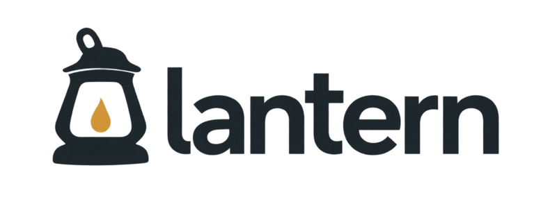

<p align="center">
  <picture>
    <source media="(prefers-color-scheme: dark)" srcset="assets/lantern-wordmark-dark.png">
    
  </picture>
</p>

<p align="center">
  Explore Minecraft server internals from a desktop app, the command line, or your coding agent.
</p>

<p align="center">
  <sub>Lantern is not an official Minecraft product. It is not approved by or associated with Mojang or Microsoft.</sub>
</p>

<p align="center">
  <a href="#getting-started">Getting started</a>
  &nbsp;·&nbsp;
  <a href="#usage">Usage</a>
  &nbsp;·&nbsp;
  <a href="#mcp-setup">MCP setup</a>
  &nbsp;·&nbsp;
  <a href="#development">Development</a>
</p>

<br>

- **Browse** decompiled Java, trace method calls, and inspect field references, tags, and registry keys.
- **Compare** source code and datapack files between Minecraft versions.
- **Search** by keywords or meaning with local embedding models and rerankers.
- **Ask** a chat model to investigate the code using Lantern's tools.

## Getting started

Build the CLI and MCP server with Rust and Cargo. Install Java 21 or newer for decompilation, then run the interactive setup:

```sh
cargo build --release --locked -p lantern-cli -p lantern-mcp
./target/release/lantern setup
```

Setup downloads selected Minecraft versions from 26.1 onward, decompiles them with Vineflower, builds indexes, and optionally generates embeddings. Chat configuration is optional.

For the desktop app, install development libraries for GTK 4.22+, Pango 1.56+, and GtkSourceView 5, plus GLib development tools:

```sh
cargo run --release --locked -p lantern-ui
```

The first-run wizard guides you through versions, models, and optional chat setup. Indexes, models, and settings live in Lantern's platform data directory. Commands use the selected version's index; `--db` or `LANTERN_DB` overrides it.

## Usage

```sh
./target/release/lantern class Creeper
./target/release/lantern callers Creeper.tick
./target/release/lantern ask "How do villagers summon an iron golem?"
./target/release/lantern compare 26.1 26.2 Creeper
./target/release/lantern --help
```

Semantic search requires embeddings. Comparison accepts two downloaded, decompiled versions or two source directories. The desktop app provides the same browsing, search, and comparison workflows.

<details>
<summary>Index an existing JAR and source tree</summary>

Use the inner server JAR containing `net/minecraft` classes. Sources and datapack data are optional; their directories should contain `net/` and `minecraft/`, respectively.

```sh
./target/release/lantern index --jar /path/to/server-inner.jar \
  --src /path/to/decompiled --data /path/to/data --version VERSION
```

</details>

## MCP setup

After setup, register Lantern with your coding agent. The chosen client's CLI (`claude` or `codex`) must be available on `PATH`:

```sh
./target/release/lantern setupmcp claudecode
./target/release/lantern setupmcp codex
```

Run the command for your client, then start a new session and use `/mcp` to check the connection. Claude Code registration uses user scope. You can also inspect registration with `claude mcp get lantern` or `codex mcp list`.

Lantern locates `lantern-mcp` beside its CLI and registers absolute paths to the server and selected index. Use `--mcp-bin /path/to/lantern-mcp` or `--db /path/to/lantern.db` to override them. The client starts the stdio server automatically.

> [!IMPORTANT]
> The MCP server is for your own agent on your own machine. Do not host it on the internet or offer it as a service: it hands decompiled Minecraft code to whoever queries it. See [Disclaimer](#disclaimer).

Try: “Use Lantern to inspect Creeper and trace its explosion logic to the Java source.” See the [Claude Code](https://code.claude.com/docs/en/mcp) and [Codex](https://learn.chatgpt.com/docs/extend/mcp?surface=cli) MCP documentation for client configuration.

## Development

With the desktop build dependencies installed:

```sh
cargo check --workspace --all-targets --locked
cargo clippy --workspace --all-targets --locked
cargo test --workspace --locked
cargo +nightly fmt --all -- --check
```

Formatting requires nightly Rustfmt for crate-level import grouping. CI also lints GitHub workflows with actionlint. Clippy currently reports warnings without treating them as errors.

## Updates

**Setup → About** shows the app version and checks published stable releases on request. The CLI reports its version with `lantern --version`.

GitHub Actions builds CLI/MCP archives for Linux, Windows, and macOS, plus a Linux desktop archive. Matching version tags create draft releases after checks pass. See [release instructions](docs/releases.md) for publishing and runtime requirements.

## Disclaimer

Lantern is not an official Minecraft product. It is not approved by or associated with Mojang or Microsoft.

Lantern contains no Minecraft code. It downloads the server from Mojang's own servers to your machine and decompiles it there, for your personal use. The [Minecraft EULA](https://www.minecraft.net/eula) applies to the game files and everything made from them.

- **Keep it to yourself.** Do not share or publish the server jar, the decompiled sources, the indexes (`index.db` holds the decompiled code) or the vectors made from them. That includes uploading them to a repository or attaching them to a release.
- **Run the MCP server locally.** It is meant for your own coding agent over stdio. Do not host it, expose it on a network, or offer it as a service to others.
- **Mind where the code goes.** With a cloud chat model or a cloud coding agent, the code Lantern looks up is sent to that provider. Use a local model if that is a concern.

## License

Licensed under [GPL-3.0-only](LICENSE). Bundled [Lucide icons](crates/lantern-ui/src/theme/icons/LICENSE), [IBM Plex Sans](crates/lantern-ui/src/theme/fonts/OFL-IBMPlex.txt), and [Lilex](crates/lantern-ui/src/theme/fonts/OFL-Lilex.txt) retain their respective licenses.
